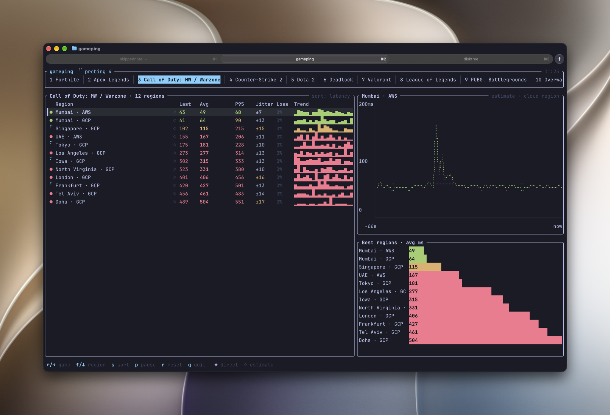

# gameping

Latency to game servers — and to the cloud regions games run in — with a live TUI.



```
gameping                      # TUI: tabs per game, live table, latency chart, best-region bars
gameping fortnite cs2         # only these games
gameping -r mumbai,singapore  # only regions matching these labels
gameping -n 20                # one-shot report, 20 samples per region
gameping --json               # one-shot report as JSON
gameping --list               # known games
```

TUI keys: `←/→` or `1-9` game · `↑/↓` region · `s` sort · `p` pause · `r` reset · `q` quit.

## How it measures

| Marker | Kind | Method |
|---|---|---|
| ◆ direct | Fortnite ping beacons, Valve SDR relays (CS2, Dota 2, Deadlock) | ICMP echo to the game's own infrastructure |
| ◇ estimate | AWS regions | TCP connect to the regional DynamoDB endpoint |
| ◇ estimate | GCP regions | HTTPS round trip on a warm connection to gcping.com's Cloud Run service |

Estimates measure the network path to the cloud region a game runs in, not the exact
match server. GCP numbers include a few ms of server time. Hosts that drop ICMP show as
`unreachable`. ICMP uses unprivileged sockets, so no `sudo` needed on macOS.

The TUI only probes the visible game, and at most 12 probes are in flight at once —
blasting ~100 targets together congests a home uplink and skews the result.

## Adding games or regions

Copy entries from [`assets/games.toml`](assets/games.toml) into
`~/.config/gameping/games.toml`. A game with an existing `id` replaces the built-in one.

```toml
[[game]]
id = "rivals"
name = "Marvel Rivals"
targets = [
  { src = "aws:ap-south-1" },
  { src = "aws:ap-southeast-1" },
  { region = "My server", src = "tcp:example.com:443" },
]
```

Sources: `icmp:<host>`, `tcp:<host>:<port>`, `aws:<region>`, `gcp:<region>`,
`valve:*` (all non-China POPs), `valve:all`, `valve:<pop>`.

## Install

Prebuilt binaries for macOS and Linux (arm64, x86_64) are on the
[releases page](https://github.com/skippednote/gameping/releases). Or from source:

```
cargo install --git https://github.com/skippednote/gameping
```

On Linux, unprivileged ICMP needs your group in `net.ipv4.ping_group_range`
(most distros allow all groups by default). Otherwise ICMP targets show as unreachable.
